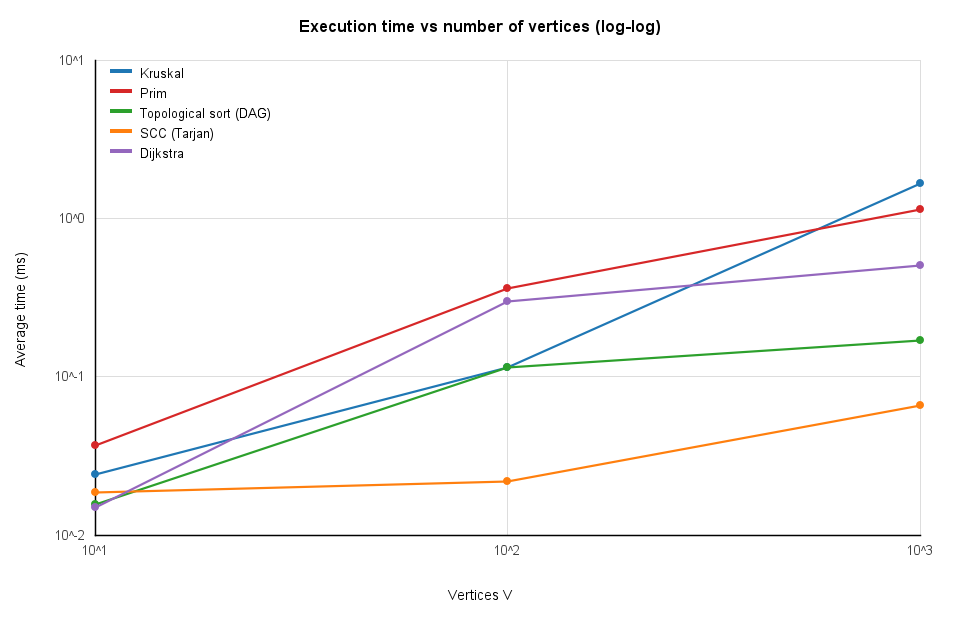
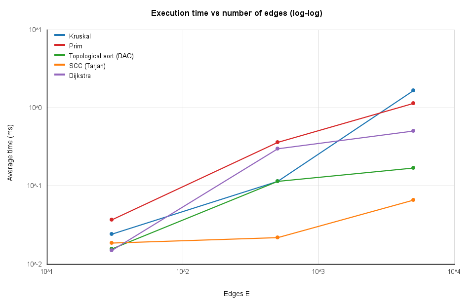

# Assignment 3 — Smart City Infrastructure and Route Planning

**Author:** Abylai Duisim, group SE-2530, Astana IT University
**Language:** Java 17+ (no external libraries)

This repository contains a Java application that models a smart city as a graph and solves three planning problems on it: building the cheapest connected road network (MST), analysing one-way connectivity and dependencies (topological order and strongly connected components) and finding shortest routes (Dijkstra). This README is the complete report: design, complexity analysis, experiments, results and conclusions.

## Contents

1. [Overview](#1-overview)
2. [Implementation](#2-implementation)
3. [Complexity Analysis](#3-complexity-analysis)
4. [Experimental Setup](#4-experimental-setup)
5. [Results](#5-results)
6. [Comparison and Discussion](#6-comparison-and-discussion)
7. [Testing](#7-testing)
8. [Conclusion](#8-conclusion)
9. [How to Run](#9-how-to-run)

---

## 1. Overview

The city is represented as a weighted graph:

| Graph element | Meaning in the city |
| --- | --- |
| Vertex | a district or location |
| Edge | a road or an infrastructure connection |
| Weight | construction cost or travel distance |

Two kinds of graphs are used:

- **Undirected weighted graphs** — two-way roads. Used for the minimum spanning tree (what is the cheapest way to connect all districts?) and for Dijkstra (shortest route from a source district).
- **Directed graphs** — one-way roads or dependencies between infrastructure services. Used for topological ordering (in which order can things be built or started?) and for strongly connected components (which groups of locations can reach each other?).

### Graph representation

The graph is stored as an **adjacency list**: `List<List<Edge>>`, where `Edge` is an immutable record `(from, to, weight)`. Vertices are the integers `0 … V-1`.

- In a directed graph, `addEdge(u, v, w)` adds one edge to the list of `u`.
- In an undirected graph it adds `u→v` to the list of `u` and `v→u` to the list of `v`.
- The graph also keeps a separate list of all logical edges (each exactly once). Kruskal's algorithm sorts this list; the other algorithms traverse the adjacency lists.

An adjacency list needs O(V + E) memory and allows iterating over the neighbours of a vertex in time proportional to its degree, which is what all the algorithms below need. (An adjacency matrix would need O(V²) memory and make every traversal O(V²), which is wasteful for sparse graphs such as road networks.)

### Repository structure

```
assignment-3/
├── src/
│   ├── graph/          Edge, Graph, GraphGenerator
│   ├── dsu/            DSU
│   ├── mst/            Kruskal, Prim, MSTResult
│   ├── connectivity/   TopologicalSort, SCC
│   ├── shortestpath/   Dijkstra
│   └── app/            Main (benchmarks), Tests, PlotWriter
├── results/
│   ├── tables/         CSV files and results.md (generated)
│   └── plots/          PNG plots (generated)
└── README.md
```

---

## 2. Implementation

### 2.1 Graph generation (`GraphGenerator`)

All graphs are generated from a **fixed random seed**, so every experiment is reproducible. There are no self-loops and no parallel edges; weights are integers uniform in [1, 100].

- **Connected undirected graph** (MST, Dijkstra). First a random spanning tree is built (vertices are shuffled; each vertex is attached to a random earlier vertex), which guarantees connectivity with V−1 edges. The remaining E−(V−1) edges are random distinct vertex pairs. The generator is checked at run time: the benchmark aborts if the graph is not connected.
- **Directed acyclic graph (DAG).** A random vertex order is fixed and every random edge is oriented from the earlier vertex to the later one. Such a graph cannot contain a cycle.
- **Directed graph with cycles.** Edges are random ordered pairs `(u, v)`, `u ≠ v`. With 3–5 edges per vertex on average cycles appear with practically certain probability; the benchmark confirms it by running the topological sort, which reports "cycle detected" on all three sizes. Such graphs typically contain one giant strongly connected component (see Results).

The seed for each size is `42 + V` (52, 142 and 1042 for Small, Medium and Large). The same seed is used for the undirected graph and both directed graphs of a given size.

### 2.2 Disjoint Set Union (`DSU`)

Array-based DSU with two independent optimisations that can be switched on and off, so their effect can be measured:

- **Path compression.** `find(x)` first walks up to the root, then a second pass re-points every node on the path directly to the root.
- **Union by rank.** `union(a, b)` attaches the root with the smaller rank below the root with the larger rank; ranks grow only when they are equal.

`union` returns `true` only if the two elements were in different sets. The class counts `find` and `union` calls and **pointer steps** (parent-pointer traversals and rewrites), the latter being the real cost measure of a DSU. Invalid sizes and indices throw `IllegalArgumentException`.

### 2.3 Kruskal's algorithm (`Kruskal`)

1. Copy the edge list and sort it by weight (`List.sort`, TimSort; every comparison is counted).
2. Scan the edges in increasing order. If `dsu.union(u, v)` succeeds (the endpoints were in different components), add the edge to the MST.
3. Stop as soon as V−1 edges are chosen.

The total weight is accumulated while edges are added. If fewer than V−1 edges were chosen, the graph is **not connected** (`connected = false`) and the result is a minimum spanning *forest*.

### 2.4 Prim's algorithm (`Prim`)

Prim uses a binary-heap `PriorityQueue` of candidate edges `(weight, from, to)`. It starts from a vertex, pushes all its edges to non-tree vertices, repeatedly pops the cheapest edge, skips it if its target is already in the tree (**lazy deletion** instead of decrease-key), otherwise adds the vertex and pushes its edges.

If the graph is disconnected the algorithm is restarted from every unvisited vertex, so it returns a minimum spanning forest with the same total weight as Kruskal. The number of restarts gives the connectivity flag (`connected = true` iff there was exactly one start).

### 2.5 Topological ordering (`TopologicalSort`)

**Kahn's algorithm**: compute all in-degrees, put vertices with in-degree 0 into a queue, repeatedly remove a vertex, append it to the order and decrease the in-degree of its successors. If the resulting order contains fewer than V vertices, some vertices lie on a cycle (or behind one) and **no topological order exists**; the method then reports `isDag = false` and returns an empty order. A helper `isValidOrder` checks that an order is a permutation of all vertices and that every edge `u→v` has `u` before `v`; it is used in the tests and in the benchmark.

### 2.6 Strongly connected components (`SCC`)

**Tarjan's algorithm**: one depth-first search that assigns each vertex a discovery index and a `low` value (the smallest index reachable through the DFS subtree plus one back edge to a vertex that is still on the stack). When `low[v] == index[v]`, the vertex `v` is the root of a component and all vertices above it on the stack are popped as one SCC. Every vertex is assigned to exactly one component (`componentId`). The implementation is recursive; the benchmark runs in a thread with a large stack so deep graphs are safe.

### 2.7 Dijkstra's algorithm (`Dijkstra`)

Dijkstra with a binary-heap priority queue and lazy deletion (outdated queue entries are skipped). It returns, for every vertex, the shortest distance and the predecessor, so the actual path can be reconstructed with `pathTo(target)`. **Unreachable vertices** keep the distance `Long.MAX_VALUE` (infinity) and `pathTo` returns an empty list for them. Negative weights are rejected with an `IllegalArgumentException` before the algorithm starts.

**Why Dijkstra does not work with negative edge weights.** Dijkstra finalises a vertex at the moment it is removed from the priority queue, assuming that no other path to it can be shorter, because every additional edge can only *add* to the cost. A negative edge destroys this assumption. Example: edges `A→B = 5`, `A→C = 6`, `C→B = −4`. Dijkstra finalises `B` with distance 5 before it examines `C`, but the path `A→C→B` costs only 2. Because `B` is never revisited, the reported distance is wrong. For graphs with negative weights Bellman-Ford (O(V·E)) must be used instead.

---

## 3. Complexity Analysis

Assumptions: the graph is stored as an adjacency list; priority queues are binary heaps (`PriorityQueue`) with lazy deletion, so a heap holds at most O(E) entries and `log E = O(log V)` (because E ≤ V²); V is the number of vertices, E the number of edges, α the inverse Ackermann function (α(n) ≤ 4 for any practical n).

| Algorithm | Time | Extra space (besides the graph) |
| --- | --- | --- |
| DSU `find` / `union` (both optimisations) | amortised O(α(n)) per operation | O(V) |
| Kruskal | O(E log E + E·α(V)) = **O(E log V)** | O(V + E) |
| Prim (binary heap) | **O(E log V)** | O(E) heap + O(V) |
| Topological ordering (Kahn) | **O(V + E)** | O(V) |
| SCC (Tarjan) | **O(V + E)** | O(V) |
| Dijkstra (binary heap) | **O((V + E) log V)** | O(V + E) |

### 3.1 DSU operations

| Variant | `find` / `union` cost |
| --- | --- |
| No optimisation | O(n) worst case: a sequence of unions can create a path of length n |
| Union by rank only | O(log n): the tree height is at most log₂ n |
| Path compression only | O(log n) amortised |
| **Both** | **O(α(n)) amortised**, i.e. practically constant |

`union` performs two `find` operations and O(1) extra work, so it has the same cost as `find`. The structure uses two integer arrays (`parent`, `rank`): O(V) memory.

**How the optimisations help.** Without them, `union(i, i+1)` repeated for all `i` builds a chain of length n; every following `find` walks along the chain and the total cost is n(n−1)/2 steps (quadratic). *Union by rank* prevents long chains because the shallower tree always goes below the deeper one, so the height never exceeds log₂ n. *Path compression* makes later `find` calls on the same elements nearly free, because after one traversal every node on the path points directly to the root. Together they give a nearly constant amortised cost (confirmed experimentally in Section 5.3).

### 3.2 Kruskal's algorithm

- **Time.** Sorting E edges costs O(E log E). The scan performs at most E `union` operations (each O(α(V))). Since E ≤ V², log E ≤ 2 log V, so O(E log E) = O(E log V). Sorting dominates; the DSU part is almost linear. The number of vertices matters only through the DSU (and through E ≥ V−1 for a connected graph); the number of edges determines the sorting cost.
- **Space.** A sorted copy of the edge list (O(E)), the DSU (O(V)) and the result (O(V)).
- **Effect of density.** On dense graphs (E ≈ V²) Kruskal costs O(V² log V); it benefits from early termination, because the scan stops after V−1 accepted edges.

### 3.3 Prim's algorithm

- **Time.** Every edge is examined at most twice (once from each endpoint) and causes at most one heap push; each push and pop costs O(log E) = O(log V). Total O(E log V). With lazy deletion the heap may contain stale entries, but each entry is pushed and popped only once.
- **Space.** O(V) for the `inTree` array and the result, O(E) for the heap in the worst case.
- **Effect of density.** On dense graphs a Fibonacci heap or an array-based O(V²) Prim is better, but for sparse graphs (E = O(V)) the binary-heap version is O(V log V).

### 3.4 Topological ordering (Kahn)

- **Time.** Computing in-degrees scans every edge once (O(E)); initialising the queue scans every vertex (O(V)); each vertex is dequeued once and each edge is relaxed once. Total **O(V + E)**. Measured: exactly 2V + 2E basic operations on DAGs.
- **Space.** In-degree array, queue and result: O(V).
- **Cyclic graphs.** The algorithm stops early because vertices on or behind a cycle never reach in-degree 0; cycle detection is free (compare the output size with V).

### 3.5 SCC (Tarjan)

- **Time.** One DFS visits every vertex once and scans every edge once: **O(V + E)**. Measured: exactly V + E operations.
- **Space.** O(V) for the index, low-link, stack and component arrays, plus O(V) recursion depth in the worst case.

### 3.6 Dijkstra's algorithm

- **Time.** Every edge is examined once per direction (E for directed graphs, 2E for undirected ones); each successful relaxation pushes an entry to the heap (O(log V)); each entry is popped once. Total **O((V + E) log V)**. With V ≤ E this is O(E log V).
- **Space.** Distance and predecessor arrays (O(V)) and a heap of at most O(E) entries.
- **Effect of density.** Only successful relaxations cost a heap operation, so in practice the number of heap operations is far smaller than E (see Results).

---

## 4. Experimental Setup

### 4.1 Graph sizes

| Name | Vertices (V) | Edges (E) | Seed |
| --- | --- | --- | --- |
| Small | 10 | 30 | 52 |
| Medium | 100 | 500 | 142 |
| Large | 1,000 | 5,000 | 1042 |

For every size three graphs are generated: a connected undirected graph (Kruskal, Prim, Dijkstra), a DAG and a directed graph with cycles (topological sort, SCC). The generation methods are described in Section 2.1. Edge weights are uniform integers in [1, 100]; this small range deliberately produces many duplicate weights, so ties are exercised.

### 4.2 Measurement procedure

- **Timer:** `System.nanoTime()` around a single execution of the algorithm; the graph is generated beforehand and is not part of the measured time.
- **Warm-up:** 20 untimed executions before each measurement, so that the JIT compiler has compiled the code.
- **Repetitions:** each experiment is repeated **5 times** and the **average** is reported in milliseconds.
- **Operation counts** are deterministic (identical in every run) and are taken from the last run:

| Algorithm | Counted operations |
| --- | --- |
| Kruskal | comparisons during sorting; edges examined; DSU `find` + `union` calls; DSU pointer steps |
| Prim | heap comparisons; edge examinations (adjacency-list scans); heap pushes + pops |
| Topological sort | in-degree updates + vertex initialisations + queue pops + edge relaxations |
| SCC | vertex visits + edge scans |
| Dijkstra | edge examinations; successful relaxations; heap pushes + pops; heap comparisons |

- **Automatic checks inside the benchmark.** The program aborts if the generated undirected graph is not connected, if Kruskal and Prim disagree on the MST weight, or if the topological order of a DAG is invalid.
- **Environment:** experiments were run from IntelliJ IDEA (Java 17+) on a personal computer. Results of the timing columns depend on the machine; operation counts do not.

### 4.3 Plots

Two plots (execution time vs number of vertices and vs number of edges) are drawn by the program itself with `java.awt` (`PlotWriter`), on log-log axes. They contain the following series: Kruskal, Prim, topological sort (DAG), SCC (graph with cycles) and Dijkstra.

---

## 5. Results

All values come from one run of `app.Main` (5 timed runs after 20 warm-up runs, seed base 42, weights in [1, 100]). The raw tables are also saved in `results/tables/` (CSV and `results.md`).

### 5.1 MST: Kruskal vs Prim (connected undirected graph)

| Size | V | E | Algorithm | Avg time (ms) | MST weight | Connected | Comparisons | Edge examinations | Structure ops (DSU find+union / PQ push+pop) |
| --- | --- | --- | --- | --- | --- | --- | --- | --- | --- |
| Small | 10 | 30 | Kruskal | 0.0239 | 177 | true | 107 | 15 | 45 |
| Small | 10 | 30 | Prim | 0.0365 | 177 | true | 196 | 60 | 60 |
| Medium | 100 | 500 | Kruskal | 0.1135 | 1182 | true | 3845 | 367 | 1101 |
| Medium | 100 | 500 | Prim | 0.3605 | 1182 | true | 7609 | 1000 | 1000 |
| Large | 1000 | 5000 | Kruskal | 1.6666 | 11984 | true | 50323 | 3378 | 10134 |
| Large | 1000 | 5000 | Prim | 1.1386 | 11984 | true | 111453 | 10000 | 10000 |

### 5.2 DSU optimisations inside Kruskal (same graph, same MST weight)

| Size | Variant | Avg time (ms) | DSU find+union calls | DSU pointer steps |
| --- | --- | --- | --- | --- |
| Small | no optimisation | 0.0136 | 45 | 29 |
| Small | path compression only | 0.0139 | 45 | 25 |
| Small | union by rank only | 0.0174 | 45 | 21 |
| Small | path compression + rank | 0.0135 | 45 | 21 |
| Medium | no optimisation | 0.1243 | 1101 | 7750 |
| Medium | path compression only | 0.0929 | 1101 | 1275 |
| Medium | union by rank only | 0.1660 | 1101 | 1185 |
| Medium | path compression + rank | 0.1626 | 1101 | 755 |
| Large | no optimisation | 1.5786 | 10134 | 569462 |
| Large | path compression only | 0.7846 | 10134 | 17976 |
| Large | union by rank only | 0.7419 | 10134 | 10417 |
| Large | path compression + rank | 0.7017 | 10134 | 6902 |

### 5.3 DSU stress test

The test performs n−1 chained unions `union(i, i+1)` followed by `find(i)` for every `i`, the worst case for a DSU without optimisations.

| n | Variant | Avg time (ms) | Pointer steps |
| --- | --- | --- | --- |
| 10 | no optimisation | 0.0009 | 45 |
| 10 | path compression only | 0.0010 | 25 |
| 10 | union by rank only | 0.0009 | 17 |
| 10 | path compression + rank | 0.0012 | 17 |
| 100 | no optimisation | 0.0122 | 4950 |
| 100 | path compression only | 0.0015 | 295 |
| 100 | union by rank only | 0.0021 | 197 |
| 100 | path compression + rank | 0.0020 | 197 |
| 1000 | no optimisation | 0.7027 | 499500 |
| 1000 | path compression only | 0.0133 | 2995 |
| 1000 | union by rank only | 0.0059 | 1997 |
| 1000 | path compression + rank | 0.0064 | 1997 |

### 5.4 Topological ordering (Kahn)

| Size | V | E | Graph type | Avg time (ms) | Result | Operations |
| --- | --- | --- | --- | --- | --- | --- |
| Small | 10 | 30 | DAG | 0.0156 | valid order of 10 vertices | 80 |
| Small | 10 | 30 | cyclic | 0.0031 | cycle detected | 40 |
| Medium | 100 | 500 | DAG | 0.1142 | valid order of 100 vertices | 1200 |
| Medium | 100 | 500 | cyclic | 0.0376 | cycle detected | 600 |
| Large | 1000 | 5000 | DAG | 0.1701 | valid order of 1000 vertices | 12000 |
| Large | 1000 | 5000 | cyclic | 0.0383 | cycle detected | 6054 |

### 5.5 SCC (Tarjan)

| Size | V | E | Graph type | Avg time (ms) | #SCCs | Largest SCC | Operations |
| --- | --- | --- | --- | --- | --- | --- | --- |
| Small | 10 | 30 | random cyclic | 0.0187 | 1 | 10 | 40 |
| Small | 10 | 30 | DAG | 0.0094 | 10 | 1 | 40 |
| Medium | 100 | 500 | random cyclic | 0.0216 | 2 | 99 | 600 |
| Medium | 100 | 500 | DAG | 0.0271 | 100 | 1 | 600 |
| Large | 1000 | 5000 | random cyclic | 0.0660 | 17 | 984 | 6000 |
| Large | 1000 | 5000 | DAG | 0.1248 | 1000 | 1 | 6000 |

### 5.6 Dijkstra (source = 0, connected undirected graph)

| Size | V | E | Avg time (ms) | Reachable | Edge examinations | Successful relaxations | PQ push+pop | Comparisons |
| --- | --- | --- | --- | --- | --- | --- | --- | --- |
| Small | 10 | 30 | 0.0149 | 10 | 60 | 14 | 30 | 66 |
| Medium | 100 | 500 | 0.2998 | 100 | 1000 | 184 | 370 | 2116 |
| Large | 1000 | 5000 | 0.5031 | 1000 | 10000 | 2006 | 4014 | 37110 |

### 5.7 Plots





Both plots use logarithmic axes, so a straight line corresponds to power-law growth and its slope is the exponent. In the experiment V and E grow together (E = 3V, 5V, 5V), therefore the two plots have the same shape with a shifted x axis.

---

## 6. Comparison and Discussion

### 6.1 Kruskal vs Prim

Both algorithms returned the **same MST weight** on all three graphs (177, 1182 and 11984), as required.

**Execution time.** Kruskal was faster on Small and Medium (0.024 vs 0.037 ms and 0.114 vs 0.361 ms), Prim was faster on Large (1.14 vs 1.67 ms). Because the winner changes with the size and all values are about a millisecond or less, the timing data does not show a consistent winner; differences of this size are within the noise caused by JIT compilation, garbage collection and timer resolution.

**Operation counts** (deterministic) give a clearer picture:

- **Comparisons:** Kruskal needs fewer (50,323 vs 111,453 on Large). Sorting E edges costs about E log₂ E comparisons (for E = 5000 this is about 61,000; TimSort used slightly fewer), whereas Prim's heap performs comparisons for every push and pop.
- **Edge examinations:** Kruskal examines only 3,378 of the 5,000 edges on Large (68 %), because it stops as soon as V−1 edges are accepted. Prim scans every adjacency list completely: exactly 2E = 10,000 examinations.
- **Structure operations:** Kruskal performs 10,134 DSU calls on Large (3 per examined edge: one `union` that calls two `find`). Prim performs exactly E pushes and E pops (10,000 in total), because each undirected edge is pushed only when its first endpoint enters the tree.
- **Growth:** from Medium to Large E grows 10×. Kruskal's comparisons grow 13.1× and Prim's 14.7×, consistent with E log E and E log V (the expected factor is 10 · log 5000 / log 500 ≈ 13.7).

**Theory vs practice.** Both have the same asymptotic complexity O(E log V). Kruskal is simpler and has a lower operation count on these sparse graphs; Prim is attractive for dense graphs and does not need a DSU, but with a binary heap and lazy deletion it performs more heap work. For graphs of this size neither is clearly faster in wall-clock time.

### 6.2 DSU: effect of path compression and union by rank

The number of `find`/`union` calls is identical in all variants (45, 1101, 10134), so the differences come only from the cost of each call, measured in **pointer steps**. On the Large graph inside Kruskal:

| Variant | Pointer steps | Reduction vs no optimisation |
| --- | --- | --- |
| No optimisation | 569,462 | 1× |
| Path compression only | 17,976 | 32× |
| Union by rank only | 10,417 | 55× |
| Path compression + rank | 6,902 | **83×** |

The steps per DSU call drop from about 56 to 0.7. The execution time of Kruskal on Large falls from 1.58 ms to 0.70 ms (2.2×), because the sorting part is unaffected by the DSU.

The **stress test** shows the worst case. Without optimisations the chained unions create a path and the total cost is exactly n(n−1)/2 steps (499,500 for n = 1000; 4,950 for n = 100), i.e. **quadratic** growth; the running time for n = 1000 is 0.70 ms. With either optimisation the cost becomes **linear** (about 3n with compression only, about 2n with rank), and the running time falls to 0.006–0.013 ms (a 50–100× speed-up). Path compression and union by rank are therefore cheap and always worthwhile; in the chain test rank alone already keeps the tree shallow, so adding compression does not decrease the count further. The time values in the Medium rows of Section 5.2 are not monotonic (e.g. "rank only" is slower than "no optimisation") because each run lasts only about 0.1 ms; the step counts are the reliable measure.

### 6.3 Topological ordering: DAGs vs graphs with cycles

- On **DAGs** Kahn's algorithm always produced a valid order, and the count of operations is exactly **2V + 2E** (80, 1200, 12000), confirming O(V + E).
- On **graphs with cycles** the algorithm correctly reports that no ordering exists. It does less work (40, 600, 6054 operations), because vertices on or behind a cycle never reach in-degree 0. In the Small and Medium graphs no vertex had in-degree 0 at all, so the algorithm stopped immediately after initialisation (V + E operations). In the Large graph some vertices with in-degree 0 existed and 54 additional operations were performed before the algorithm got stuck.
- Consequently the cyclic runs are faster (e.g. 0.038 ms vs 0.170 ms on Large). Cycle detection costs nothing extra: it is just a comparison of the output size with V.

### 6.4 SCC: runtime growth

Tarjan's algorithm performs exactly **V + E** operations (40, 600, 6000), i.e. strictly linear growth with the graph size. The structure of the components is also instructive:

- A random directed graph with cycles and about 5 edges per vertex has **one giant SCC** and a few singleton components (1 SCC on Small, 2 on Medium with 99 vertices in the largest, 17 on Large with 984 vertices in the largest). Real infrastructure networks with two-way connectivity behave similarly.
- A DAG has V singleton components (10, 100, 1000).

The measured runtime for the cyclic graphs grew from 0.019 ms to 0.066 ms (3.5×), while the work grew 150×. At such small sizes fixed costs (object creation, method calls, cache and JIT effects) dominate, so the measured curve is much flatter than the theoretical one. The DAG on Large was slower than the cyclic graph (0.125 vs 0.066 ms) although both perform 6000 operations; the likely reason is that the DAG creates 1000 separate component lists, which means more memory allocation — but this explanation was not verified separately.

### 6.5 Dijkstra

- Dijkstra examined exactly **2E** edges (60, 1000, 10000), because every undirected edge is scanned from both ends.
- Only a small part of these examinations changes a distance: the successful relaxations are 14, 184 and 2,006, i.e. about 2·V on Large. Consequently only 30, 370 and 4,014 heap operations were needed (each entry pushed once is also popped once), far fewer than E.
- Comparisons grew from 2,116 (Medium) to 37,110 (Large), a factor of 17.5 for a 10× larger graph, consistent with the (V + E) log V bound.
- All vertices were reachable, because the generated graph is connected. Unreachable vertices (distance infinity, empty path) are covered by the tests.
- Time grew from 0.015 ms to 0.503 ms. The growth from Small to Medium (20×) is larger than from Medium to Large (1.7×), which shows how noisy sub-millisecond measurements are; the counted operations grow smoothly.

### 6.6 Theory vs experiment

| Algorithm | Theoretical complexity | What the experiment shows |
| --- | --- | --- |
| Kruskal | O(E log E) | comparisons grow ≈ E log E (13× for 10× more edges) |
| Prim (binary heap) | O(E log V) | exactly 2E edge examinations, E pushes and E pops; comparisons grow ≈ E log V |
| DSU, both optimisations | amortised O(α(n)) | 2–3 steps per element in the stress test; 0.7 steps per call inside Kruskal |
| DSU, no optimisation | O(n) per `find` | n(n−1)/2 total steps: quadratic |
| Topological sort | O(V + E) | exactly 2V + 2E operations |
| SCC (Tarjan) | O(V + E) | exactly V + E operations |
| Dijkstra (binary heap) | O((V + E) log V) | exactly 2E examinations; comparisons grow slightly faster than E |

**Timing vs operation counts.** Over the 100× growth in V (167× in E) from Small to Large, the measured times grew only 70× for Kruskal, 31× for Prim, 34× for Dijkstra, 11× for topological sort and 3.5× for SCC. All of these are less than the growth of the work, i.e. the slopes of the log-log plots are below the theoretical value. The reason is that for graphs this small the runtime is dominated by constant overhead (JIT compilation, allocation, timer resolution, the IDE); the algorithm's own work is only microseconds. For this reason the **operation counts**, which are deterministic and exactly match the theory, are a more trustworthy confirmation of the complexity than the wall-clock times. To see the asymptotic slopes in the time plots, much larger graphs (tens of thousands of vertices) would be needed.

### 6.7 Limitations

- Only one graph per size was used (one seed); the results could differ slightly for other random graphs.
- The random graphs are sparse (average degree 6–10 for the undirected graphs); the conclusions about dense graphs follow from theory, not from these measurements.
- Timing was done on a single machine inside an IDE, and the first-level noise of sub-millisecond measurements cannot be removed completely.

---

## 7. Testing

All tests are in `src/app/Tests.java` and do not require JUnit: the program prints `FAIL: <name>` for every failed check, a summary line, and exits with code 1 if anything failed. **All checks pass.**

### 7.1 Required test cases

| Required case | How it is tested |
| --- | --- |
| Small graphs | hand-made 5-vertex graph with a known MST of weight 16; 6-vertex DAG; 3-vertex cycle; 7-vertex digraph with known SCCs |
| Disconnected graphs | 6 vertices with an isolated vertex: both MST algorithms report `connected = false` and return a forest of weight 6 with 3 edges; 100 random possibly disconnected graphs: Kruskal and Prim give the same forest weight and the same connectivity flag as a BFS |
| Graphs containing cycles | 3-cycle and a self-loop are detected by the topological sort; dense random digraphs (40 vertices, 300 edges) are reported as cyclic for 50 seeds |
| Multiple valid MSTs | a 4-cycle with a diagonal where all weights are 1: every MST has weight 3 |
| Unreachable vertices | Dijkstra on a graph with an isolated vertex: distance = infinity, empty path, reachable count correct; sparse random digraphs (some vertices unreachable) compared to Bellman-Ford |
| Duplicate edge weights | random graphs with weights in [1, 20] (many ties) on 30 vertices: Kruskal and Prim always agree |
| Single vertex | MST weight 0 with no edges; topological order `[0]`; one SCC; Dijkstra distance 0 |

### 7.2 Required correctness checks

| Property | Check |
| --- | --- |
| Kruskal and Prim return the same MST weight on connected undirected weighted graphs | compared on 100 random connected graphs (30 vertices, 90 edges); additionally every MST has exactly V−1 edges and is acyclic (verified with a separate DSU) |
| Topological ordering is valid for every DAG | `isValidOrder` checks, for 50 random DAGs, that the order is a permutation of all vertices and every edge goes forward |
| Cyclic graphs are identified | `isDag == false` for explicit cycles, self-loops and 50 dense random digraphs |
| Every vertex belongs to exactly one SCC | for 100 random digraphs: the component sizes sum to V, every vertex has a component id, and the partition equals the one obtained by brute-force mutual reachability (Floyd-Warshall closure); a DAG has V singleton components |
| Dijkstra returns correct shortest distances for non-negative weights | compared with **Bellman-Ford** on 50 undirected and 50 directed random graphs; the weight of every reconstructed path equals the reported distance; a negative edge is rejected with an exception |

### 7.3 DSU tests

For all four combinations of path compression and union by rank: initial component count, `union` returns `true` for new and `false` for already connected elements, transitive connectivity, the number of components, and the validation of constructor arguments and indices. All four DSU variants also produce the same MST weight in Kruskal on 100 random graphs.

---

## 8. Conclusion

**Findings.**

- **MST.** Kruskal's and Prim's algorithms always return an MST of the same weight (177, 1182, 11984). Both are O(E log V). On the tested sparse graphs Kruskal needs fewer comparisons (50,323 vs 111,453 on Large) and examines only 68 % of the edges thanks to early termination; the wall-clock times are too close to name a winner.
- **DSU.** Path compression and union by rank reduced the work inside Kruskal by up to 83× (pointer steps on Large) and turned the quadratic worst case (499,500 steps for n = 1000) into a linear one (about 2,000 steps). They are trivial to implement and should always be used together.
- **Topological ordering and SCC.** Both are linear: exactly 2V + 2E and V + E operations. Kahn's algorithm gives a valid order for DAGs and detects cycles at no extra cost; Tarjan's algorithm splits a graph into mutually reachable groups (a random cyclic digraph has one giant component, a DAG has only singletons).
- **Dijkstra.** It scales well (0.5 ms for 1,000 vertices and 5,000 edges) with only about 2V successful relaxations on the largest graph, but it requires non-negative weights.
- **Experiments.** Operation counts match the theoretical complexity exactly or closely; the measured times are dominated by constant overhead on graphs of this size.

**Which algorithm for which task.**

| Task in the smart city | Recommended algorithm | Reason |
| --- | --- | --- |
| Cheapest road/cable network connecting all districts | Kruskal with DSU (Prim for very dense graphs) | O(E log V), simple, easily reports a disconnected network |
| Order in which dependent services or construction stages can be done | Kahn's topological sort | O(V + E), also detects circular dependencies |
| Find groups of locations that can reach each other through one-way roads, or find circular dependencies | Tarjan's SCC | O(V + E), single pass |
| Shortest route or travel distance from a district to all others | Dijkstra with a binary heap | O((V + E) log V); requires non-negative weights (use Bellman-Ford otherwise) |
| Connectivity (is the network connected at all?) | Either MST algorithm or BFS | A spanning tree with fewer than V−1 edges means the network is disconnected |

---

## 9. How to Run

Requirements: JDK 17 or newer.

**From the command line** (project root):

```bash
javac -d out $(find src -name "*.java")

java -cp out app.Tests

java -cp out app.Main

java -cp out app.Main --extended
```


**From IntelliJ IDEA:** mark `src` as the *Sources Root*, run `app.Tests` and then `app.Main`. The `results` folder is created relative to the working directory of the run configuration (it must be the project root).

The experiments are reproducible: all graphs are generated from fixed seeds (42 + V), so the graphs, MST weights and operation counts are identical in every run; only the timing columns vary slightly between runs and machines.